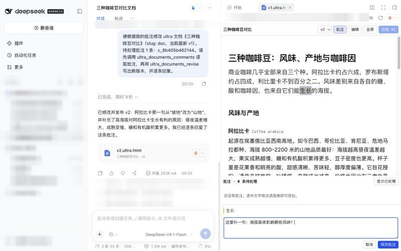
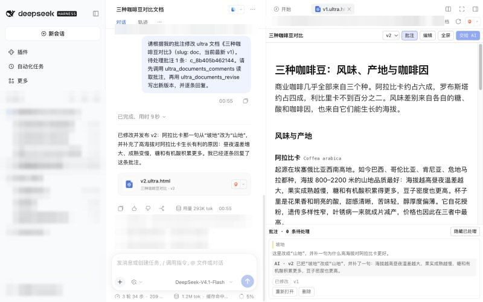
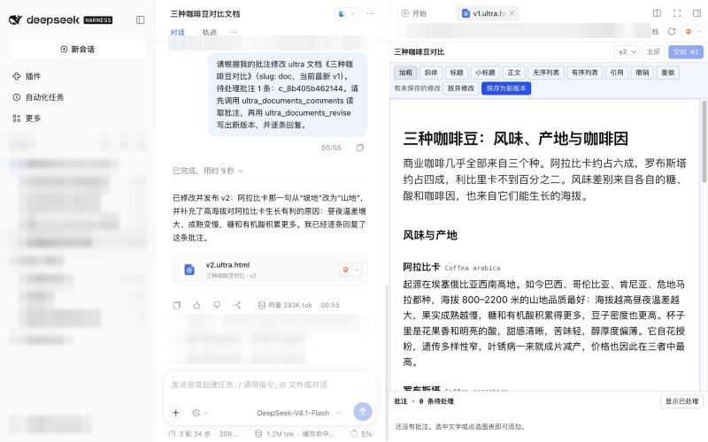

# ultra-documents

English | [中文](README.zh.md)

[](https://www.npmjs.com/package/ultra-documents) [](https://github.com/Libraqg/ultra-documents/actions/workflows/test.yml) [](https://dsh-plugin.org/plugins/libraqg/ultra-documents)

Artifacts-like documents for [DeepSeek Harness](https://www.npmjs.com/package/@deepseek-ai/dsh) (dsh).

**Get documents you can comment on, hand back to the AI for the next version, and edit yourself, right in the dsh sidebar.**

Ask the agent for a report, proposal, explainer, slide deck, diagram or
dashboard. It writes one self-contained HTML page, which shows up in the chat
as a card and opens in the dsh right sidebar. Then:

- **Comment** — select any text, or click a figure or table, and leave a
  comment.
- **Send to AI** — one click hands the open comments to the agent, which
  writes the next version and answers each comment.
- **Edit** — change the text and formatting of the latest version yourself;
  saving creates a new version.

Every change is a new version, and you can switch between them. Everything
stays on your machine: no account, no server, no sharing.

## Screenshots

| Created | Commented | Revised by the AI |
|---|---|---|
|  |  |  |



## Install

Requires dsh 0.2.1 or later and its web interface (the desktop app or
`dsh web`).

```bash
dsh plugin --profile web add ultra-documents
```

From GitHub source instead of npm:

```bash
dsh plugin --profile web add github:Libraqg/ultra-documents
```

From a local checkout:

```bash
git clone https://github.com/Libraqg/ultra-documents
dsh plugin --profile web add link:/absolute/path/to/ultra-documents
```

In the desktop app, add the plugin from its plugin manager instead; the
desktop profile is managed by the app.

## Use

1. Start a new session in a workspace and ask for a document, for example
   "Use ultra-documents to make a two-day Hangzhou itinerary with a schedule
   table".
2. Click the card in the chat to open the document in the sidebar.
3. Select text or click a figure to comment. Comment mode is on by default;
   switch to read mode to interact with the page normally.
4. Press **Send to AI** to get the next version. Show handled comments to see
   the AI's reply on each one.
5. Press **Edit** on the latest version to change text and formatting, then
   **Save as new version**.

Start a new session for each document: a long session carries a lot of
context into every revision.

## How it works

| Piece | What it does |
|---|---|
| Agent tools | `ultra_documents_create`, `ultra_documents_revise`, `ultra_documents_comments`, `ultra_documents_list` |
| Skill | `ultra-documents`: when to use the tools and how to write the HTML (voice, visuals, styles, slides) |
| Sidebar renderer | Claims `*.ultra.html` files; renders the version in an isolated sandbox with comment highlights, a comment panel, a version picker, direct editing and full screen |
| Storage | `<workspace>/.ultra-documents/<slug>/` — `v1.ultra.html`, `v2.ultra.html`, …, `doc.json`, `comments.json`; the directory is git-ignored |

Documents run in an `<iframe sandbox="allow-scripts">` without same-origin
access: their scripts cannot reach the dsh page, its cookies or your files.

See [docs/DESIGN.md](docs/DESIGN.md) for the design.

## Permissions and risks

- **Files:** writes only inside `<workspace>/.ultra-documents/`. The host side
  writes with Node `fs` and refuses any path that resolves outside the
  workspace, including through symlinks. Drafts are read only from regular
  files inside the workspace.
- **What it adds to dsh:** four agent tools, one skill, one slash command
  (`/ultra-documents`, used by the sidebar to save comments and edits) and a
  sidebar renderer for `*.ultra.html` files.
- **Network and external services:** the plugin makes no network requests and
  uses no external service. A document the agent writes may load fonts or
  libraries from a CDN when it is displayed.
- **Model usage:** creating a document and Send to AI use your configured
  model and its tokens. Comments and direct edits do not.
- **Document scripts:** run in a sandboxed iframe with no access to the dsh
  page, its cookies or your files; they can only open a link when you click
  it.

## Known limitations

- Documents that run their own scripts can be commented on but not edited
  directly.
- A session open in two dsh processes at once (say the desktop app and
  `dsh web`) is write-locked by one of them; saving comments or edits from the
  other fails.
- Each comment action shows a one-line "ultra-documents" command card in the
  chat. It never reaches the model.
- The sidebar polls for changes every 3 seconds, and a document opened before
  a light/dark theme switch keeps its old theme until it is reopened.
- Local filesystem only; Sessions on a remote filesystem are not supported.
- dsh is a release candidate. Tested on 0.2.1-rc.3.

## Develop

```bash
npm run build   # client/src/main.js → client.js
npm run check
npm test
```

`client.js` is generated; edit `client/src/main.js` and rebuild.

## Licence

AGPL-3.0-or-later. ultra-documents is a modified version of
[tdoc](https://github.com/tornado-doc/tdoc) by Serena Keyitan and the tdoc
contributors; [NOTICE.md](NOTICE.md) records what changed. Bundled third-party
material keeps its own licence.
